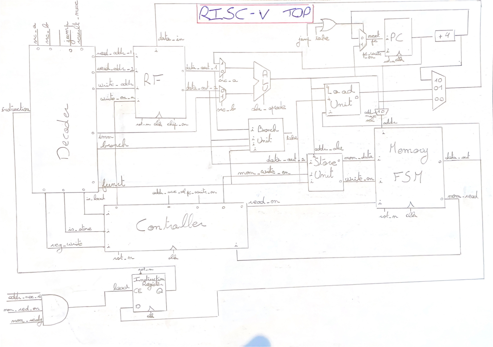
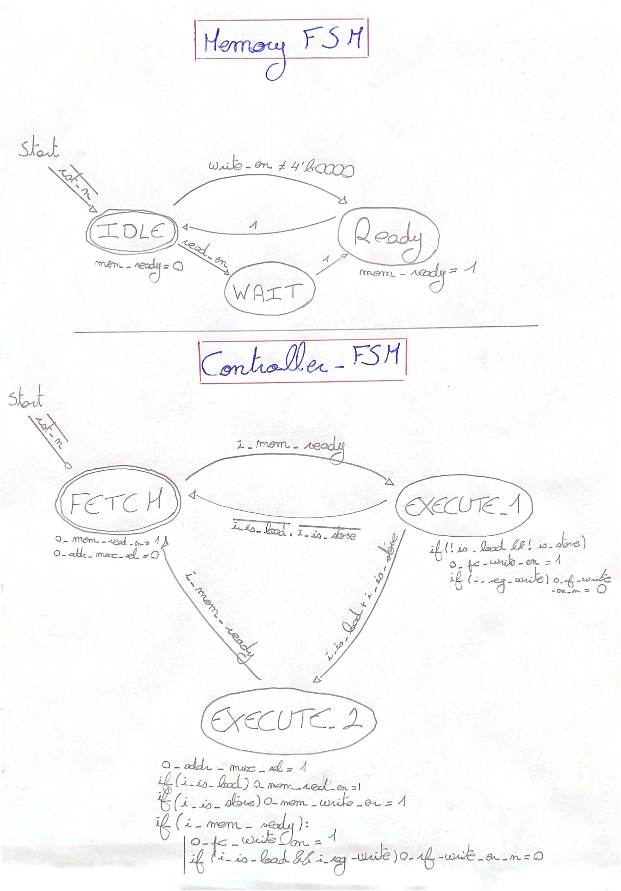
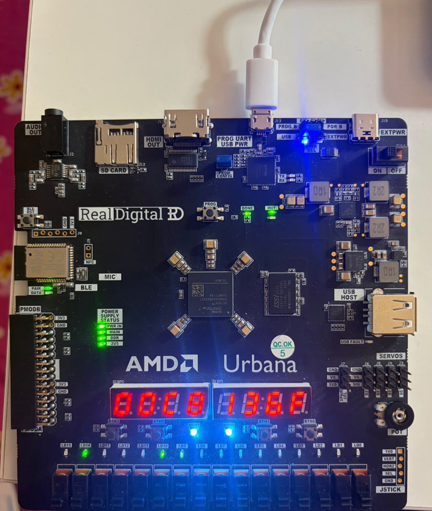

# RISC-V RV32I Multi-Cycle Core

This repository contains the RTL design, verification, and physical implementation of a 32-bit RISC-V processor (RV32I Base Integer Instruction Set). The core is based on a multi-cycle, Von Neumann architecture and has been successfully targeted and verified on an AMD Xilinx Spartan-7 FPGA.

## Project Structure

*   `rtl/`: SystemVerilog source files for the core (ALU, Controller, Datapath, Decoder, etc.) and top-level integration.
*   `simulation/`: Testbenches for individual modules and full-system behavioral verification.
*   `program/`: C and Assembly firmware (`.c`, `.asm`, `.hex`) executed by the core, alongside isolated RISC-V tests.
*   `constraints/`: Xilinx Design Constraints (`urbana.xdc`) for physical pin mapping and timing.

## Architecture

The design relies on a multi-cycle central Finite State Machine (FSM) rather than a pipelined approach, optimizing hardware resource reuse (e.g., a shared ALU for addressing and execution). It uses a Von Neumann memory architecture where instructions and data share the same bus.

### Top-Level Datapath
The datapath integrates the Register File, ALU, Program Counter (PC), Memory Controller, and dedicated instruction decoding logic.

*Figure 1: Top-level architecture and datapath integration.*

### Control Unit & Memory FSM
The execution is orchestrated by two interlocked FSMs: a central controller that sequences the instruction phases (Fetch, Execute 1, Execute 2) and a Memory FSM that handles the latency of read/write operations.

*Figure 2: Multi-cycle Main Controller and Memory access FSMs.*

## Physical Implementation

The core has been fully synthesized, placed, and routed using Xilinx Vivado, targeting the Urbana FPGA development board.

*Figure 3: RISC-V core execution on the AMD Xilinx Spartan-7 (Urbana Board).*

### Performance & Resource Metrics

| Category | Metric | Value | Details |
| :--- | :--- | :--- | :--- |
| **Hardware** | Target Device | `xc7s50csga324-1` | Urbana Board (Spartan-7) |
| | Target Clock | 100 MHz | 10 ns period |
| **Timing** | Setup Slack (WNS) | +5.643 ns | Constraints met |
| | Max CPU Freq ($F_{max}$) | ~81.6 MHz | Evaluated via isolated run |
| **Utilization (SoC)** | LUTs | 1496 | 4.59% of available |
| | Flip-Flops | 1173 | 1.80% of available |
| | Block RAM (BRAM) | 16 | 21.33% of available |
| **Power** | Total Power | 94 mW | Total On-Chip Power |
| | Dynamic Power | 19 mW | Switching logic |